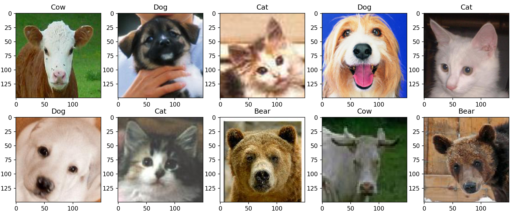
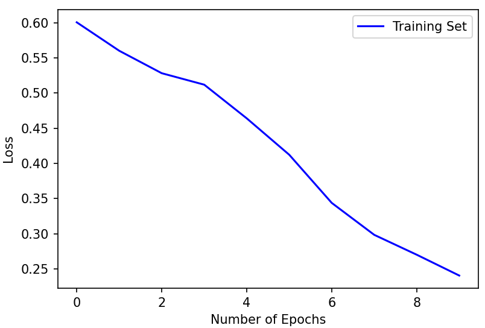
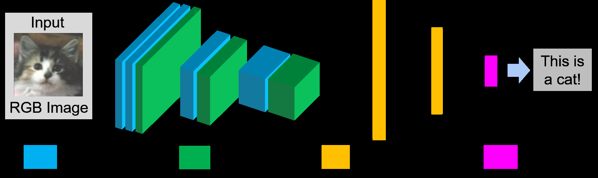
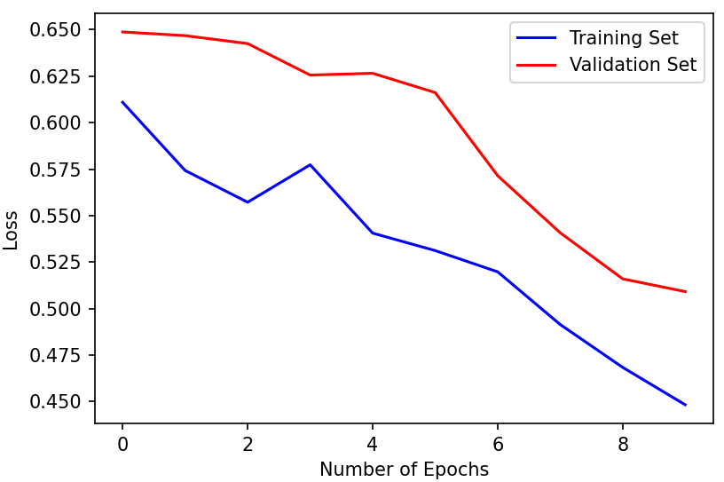

|     |     | AER 1515 | - Perception |     | for | Robotics |
| --- | --- | -------- | ------------ | --- | --- | -------- |
|     |     |          | Assignment   |     | 1   |          |
Submission guidelines: This assignment is due on Friday, October 16, 2026 at 11:59 pm. Please submit
| only a single  | typed | solutions as a PDF  | file. |        |     |          |
| -------------- | ----- | ------------------- | ----- | ------ | --- | -------- |
| Classification |       | Using Convolutional |       | Neural |     | Networks |
Theconvolutionalneuralnetwork(CNN)representsahugebreakthroughinimagerecognitionandisfrequently
used in image classification tasks. In this assignment, you will build a CNN for an animal classification task.
The images of animal faces are from the LHI-Animal-Faces dataset. It consists of 20 classes, 19 classes of
differentanimals, andonehumanfacesclass. Youareprovidedwith2313trainingimagesand100testimages.
| The dataset | is located | in ./AnimalFace. |             |     |                  |          |
| ----------- | ---------- | ---------------- | ----------- | --- | ---------------- | -------- |
|             |            | Figure 1: Sample | images from | the | LHI-Animal-Faces | dataset. |
| To Start    | With       |                  |             |     |                  |          |
We recommend Python 3.11. Please install PyTorch (torch and torchvision) following the official instruc-
| tions for | your system | at https://pytorch.org/get-started/locally/. |     |     |     |     |
| --------- | ----------- | -------------------------------------------- | --- | --- | --- | --- |
For detailed setup instructions, please refer to the Installation section of ./readme.txt included in the
| download    | package. |                |                |     |     |          |
| ----------- | -------- | -------------- | -------------- | --- | --- | -------- |
| 1 Extending |          | to Multi-Class | Classification |     |     | (15 pts) |
We start from a binary classification task using the “Cat” and “Dog” classes. This allows us to become
familiar with the provided CNN training and evaluation pipeline. The training script train.py trains the
CNN and saves the trained model as model.pt, while test.py loads the saved model and evaluates its
classification accuracy. We then extend the same CNN to the full 20-class classification task.
Questions
1. (5 pts) Run train.py and train the provided binary CNN classifier until convergence. Include the
training loss curve in your report. Figure 2 shows an example training loss curve using only ten epochs.
1

Figure 2: An example of the training loss for the binary classification task.
2. (5 pts) Runtest.pywithyoursavedCNNmodel(model.pt)inQuestion1,andreporttheclassification
accuracy on the test set.
3. (5 pts) Modify the code train.py and test.py to extend the binary classification to a multi-class
classification (20 classes) task. Show your training loss plot and report the classification accuracy on
the test set.
2

2 Modifying the CNN Architecture (25 pts)
In this section, we investigate how modifications to the CNN architecture affect classification performance.
Our default CNN architecture is defined in the file Animal Classification Network.py. It consists of 4
convolutional layers, 3 max-pooling layers, and 2 fully connected layers. We also use Rectified Linear Unit
(ReLU) as our activation function. To improve the performance, students are asked to add additional layers
to the current CNN architecture. It is up to you how many layers you add, where you add them, and what
parameters you use. When correctly tuned, you should be able to see an improved accuracy when adding
each type of layer. If you still see a small drop in performance (within 5%), it is sufficient to report the new
accuracy and discuss why adding batch normalization or dropout can hurt performance.
Figure 3: Default Network Structure for the animal classification task.
Questions
1. (15 pts) Based on current CNN architecture, add batch normalization layers and show your training
loss plot and report the classification accuracy on the test set with the modified CNN architecture. For
students who are not familiar with batch normalization, please refer to here. Hint: One possible design
is to apply batch normalization after a convolutional layer and before pooling operation.
2. (10 pts) Based on the modified CNN architecture from the previous Question, add dropout layers and
show your training loss plot and report the classification accuracy on the test set. For students who are
not familiar with dropout, please refer to here.
3. Please include your final version init () and forward() functions here. Either as formatted text or
screenshots.
3

3 Training with Validation and Data Augmentation (35 pts)
Inthestartcode, wesplitthefulltrainingdataintothetrainingset(80%)andvalidationset(20%). However,
weonlyusethetrainingsetandhavenotleveragedthevalidationsetyet. Ingeneral, weareunabletoachieve
optimal performance using only the training set. Moreover, we save the trained CNN model at the end of the
training with the last epoch. It may happen that your last epoch is NOT the one that gave you the least loss.
In this section, students will need to keep track of the loss on the validation set at each training epoch,
save the CNN model with the minimal validation loss, and explore the impact of data augmentation.
Questions
1. (25 pts) Based on your modified CNN architecture, add the validation loop within the training epochs
and save the CNN model that corresponds to the least validation loss. Please also show a plot that
includes both training loss and validation loss with at least 30 epochs. Here we show an example of
the plot with only ten epochs.
Run the evaluation on the test dataset with your saved CNN model. Please compare the classification
accuracy on the test set with the one that does not use the validation set. In practice, you may not
observe an improvement in test set accuracy when using the best model from the validation set. Include
a short commentary on why this may happen for our network/data.
Figure 4: The example plot of training loss and validation loss.
2. (10pts)Applyatleasttwodifferentdataaugmentationtechniques(e.g.,randomcrop,rotation,horizontal
flip, color jitter) during training. Again show the training and validation loss plots with augmentation
and report the test accuracy. Briefly discuss how these results compare to the ones without data
augmentation and how data augmentation impacts overfitting and generalization in this task.
(Hint: add your augmentation transforms to transform train in “animal face dataset.py”.)
3. Please include your validate() and plot losses() functions, the part of main() where you call
validate() and save the best model, and transform train here. Either as formatted text or screen-
shots.
4

| 4 Hyperparameter |     |     | Tuning |     | (25 | pts) |     |     |
| ---------------- | --- | --- | ------ | --- | --- | ---- | --- | --- |
In the modified code (up to Question 3), we use the RMSProp as our optimizer for the network training. The
| batch size | is 32, and | the learning | rate | is set | to 0.0001. |     |     |     |
| ---------- | ---------- | ------------ | ---- | ------ | ---------- | --- | --- | --- |
In this section, students will need to tune these hyperparameters and discover new combinations of
| hyperparameters, | resulting |     | in a better | classification |     | result on | the test set. |     |
| ---------------- | --------- | --- | ----------- | -------------- | --- | --------- | ------------- | --- |
Questions
1. (7 pts) Change the optimizer to another one and report the classification results on the test set. A brief
| introduction | of  | different | optimizers |     | can be | found here. |     |     |
| ------------ | --- | --------- | ---------- | --- | ------ | ----------- | --- | --- |
2. (9 pts) Select an optimizer and tune the learning rate. Please show the training and validation loss plots
with different learning rates and report the classification result on the test set. Briefly describe how the
learning rate affects the training progress (training and validation loss) and the final result on the test
set.
3. (9 pts) Select an optimizer and tune the batch size. Please show the training and validation loss plots
with different batch sizes and report the classification result on the test set. Briefly describe how the
| batch | size affects | the | training | progress | and | the final result | on the | test set. |
| ----- | ------------ | --- | -------- | -------- | --- | ---------------- | ------ | --------- |
4. (Extra Credit, 10 pts) Try your best to discover different combinations of hyperparameters (optimizer,
learning rate and batch size), and report the best test set classification result you have achieved. Please
| also | report the | corresponding |     | hyperparameters |     | for your | best result. |     |
| ---- | ---------- | ------------- | --- | --------------- | --- | -------- | ------------ | --- |
5

## Extracted Images

### Page 1

### Page 2

### Page 3

### Page 4

