AER 1515 – Perception for Robotics
Lecture 2 – Probability and Information
Prof. Steven Waslander

Probability and Information Improvements
• To be added
• Covariance and correlation (Murphy)
• Chain rule of conditional probabilities (Bengio)
• Beta and Dirichlet (Murphy)
• Sample mean and variance (Murphy)
• Mutual Information Robotics or ML Example (Murphy, others?)
• Convexity and Jensen’s inequality to allow the application of log to everything
• Generating samples from Gaussians (or from CDFs)
• Marginalization
• Maholonobis distance (eigenvect/vals) (Murphy)
• Mixture of Gaussians
2

Why Probability, Statistics, Information Theory
3

Discrete Probability Distributions
• Discrete Random Variable
• X denotes a random variable
• X can take on a countable number of values
• The probability that X takes on a specific value must fall between 0 and 1
• A 6-sided die’s probability distribution – probability mass function (PMF)
x  1 2 3 4 5 6
i
4

Continuous Probability Distributions
• Continuous Random Variable
• X takes on a value in a continuum
• Probability density function
p(x)
• Evaluated over finite intervals of the continuum
x
• Note that probability is an area, probability density is the value of the pdf at a single point. A
single point in a continuous distribution has zero probability of occurring.
5

Cumulative Distributions and Quantiles
• A cumulative distribution function (CDF), P(q), is the
probability that a random variable is less than or equal to q
• Can be computed from the pdf
• P(q) is monotonically increasing because p(x) ≥ 0, therefore P-1(α)
exists
• A quantile is then a segmentation of the CDF which can be computed
from its inverse
• The median is P-1(0.5), upper and lower quartiles are P-1(0.75) and P-1(0.25)
6

Measures of Distributions
• First Raw Moment • Second Central Moment
• Mean • Variance
• Expected value of a random variable • Measure of the variability of a random
variable
• square root of variance is standard deviation,
7

Joint Probability and Independence
• Joint Probability
• Probability of x and y:
• e.g. probability of clouds and rain today
• Independence
• If X,Y are independent, then
• e.g. probability of two heads coin-flips in a row is ¼
8

Conditional Probability
• Probability of x given y
| p(X  x | Y |  y)  p(x | | y) |
| ----------- | ---------- | ---- |
• Probability of KD for dinner, given an undergraduate Steve is cooking
• Relation to joint probability
p(x, y)
| p(x | y)  |     |     |
| ---------- | --- | --- |
p(y)
• If X and Y are independent,
| p(x | y)  | p(x) |     |
| ---------- | ---- | --- |
• Follows from the above
9

Law of Total Probability
| Discrete | Continuous |     |     |
| -------- | ---------- | --- | --- |

| p(x) | 1  |          |     |
| ---- | --- | -------- | --- |
|      |     |  p(x)dx | 1  |
x
| p(x)   | p(x, y) | p(x) |  p(x, y)dy |
| -------- | ------- | ----- | ----------- |
y
|       |              | p(x)  |  p(x | y)p(y)dy |
| ------ | ------------ | ------ | ---------------- |
| p(x)  | p(x | y)p(y) |        |                  |
y
10

Bayes Theorem
• From definition of conditional probability
p(x,y) p(x,y)
|     | p(x| | y)  | ,    p(y| | x) |     |
| --- | ---- | ---- | --------- | --- | --- |
p(y) p(x)
|     | p(x| | y)p(y) |  p(x,y) | p(y| x)p(x) |     |
| --- | ---- | ------ | --------- | ----------- | --- |
• Bayes Theorem defines how to update one’s beliefs about X given a known
(new) value of y
|     |        | p(y | | x) p(x) | likelihood |  prior |
| --- | ------ | --- | --------- | ---------- | ------- |
| p(x | | y)  |     |           |           |         |
|     |        |     | p( y)     | evidence   |         |
11

Probability
• Bayes Theorem
• If Y is a measurement and X is the current vehicle state, Bayes Theorem can be used to update
the state estimate given a new measurement
• Prior: probabilities that the vehicle is in any of the possible states
• Likelihood: probability of getting the measurement that occurred given every possible state is the true
state
• Evidence: probability of getting the specific measurement recorded
p( y | x) p(x) likelihood  prior
p(x | y)  
p( y) evidence
12

Important Qualification
13

Common Distributions
• Uniform: Defined as equal probability mass or constant probability density
• Often used as an uninformative prior
• Maximizes entropy
• Bernoulli
• Let be a binary random variable, then X has a Bernoulli distribution with probability
of success, θ
• The Bernoulli distribution is then
14

Common Distributions
• Binomial Distribution
• Given n realizations of a binary random variable, the number of positive values
is a random variable drawn from where
• The Binomial distribution has the following mean and variance, assuming 0, 1
labels are meaningful
15

Common Distributions
• Categorical (Discrete, Multinoulli) and Multinomial
• Extension to discrete random variables that can take on more than two values
• Categorical distribution is simply probability mass function for
• Multinomial distribution is analogously the probability of x occurrences of each
j
of the j outcomes
16

Common Distributions
• Gaussian Distribution (Normal)
(x)2
1
p(x)  e 22 p(x) ~ N(,2)
2
17

Multi-variate distributions
• Vector of random variables
 X 
1
 
X  
 
X 
 
n
• Mean
18

Covariance
• Multi-variable distributions
• Covariance
• Measure of how much two random variables change together
|     | Cov(X | , X ) |  E[(X | )(X  |  )] |
| --- | ----- | ----- | ------ | ------ | ----- |
|     |       | i j   |        | i i    | j j   |
|     |       |       |  E[X  | X ] |       |
|     |       |       |        | i j    | i j   |
• If Cov(X,Y)>0, when X is above its expected value, then Y tends to be above its expected value
• If Cov(X,Y)<0, when X is above its expected value, then Y tends to be below its expected value
| • If X,Y | are independent, Cov(X,Y) |     | = 0 |     |     |
| -------- | ------------------------- | --- | --- | --- | --- |
19

Probability
• Multi-variable distribution
• Covariance Matrix, ∑
• Defines variational relationship between each pair of random variables
|   | Cov(X , X ) |     |
| --- | ----------- | --- |
| i,j | i j         |     |
• Generalization of variance, diagonal elements represent variance of each random variable
| Cov(X | , X ) Var(X | )   |
| ----- | ------------ | --- |
|       | i i          | i   |
• Covariance matrix is symmetric, positive semi-definite
20

Covariance
• Two dimensional distributions off diagonal element covariance Cov(X , X )
1 2
21

Probability
• Multiplication by a constant matrix yields
22

Common Distributions
• Multivariate Gaussian Distribution (Normal)
1
1  (xμ)T1(xμ)
p(x) ~ N(μ,)
p(x)  e 2
det(2)
23

Probability
• Properties of Gaussians
• Linear combinations remain Gaussian
• Direct Product of K Gaussians,
• where
24

Gaussians are an Exponential Family
• Exponential families have many properties that make them extremely useful for statistical
analysis. It can be shown that, except in a few exceptional cases, only exponential
families have these properties. Examples:
• Exponential families have sufficient statistics that can summarize arbitrary amounts of independent
identically distributed data using a fixed number of values.
• Mean, covariance are all that is needed to specify a Gaussian
• Exponential families have conjugate priors, an important property in Bayesian statistics.
• The posterior distribution will be of the same distribution family as the prior if the prior is a conjugate prior of the
likelihood.
p(y | x)p(x) likelihood  prior
p(x| y)  
p(y) evidence
• A Gaussian is a self-conjugate, meaning that if the likelihood and prior are Gaussian, then the posterior will be Gaussian
as well
• The Dirichlet distribution is a conjugate prior to the categorical distribution, meaning that samples of events can be
counted and used as a prior for a categorical likelihood distribution
25

Generating Samples
• Generating multivariate random noise samples from Gaussian distributions
• Define two distributions, the one of interest and the standard normal distribution
~ N(,) ~ N(0,I)
• If the covariance is full rank, it can be diagonalized
• Symmetry implies positive semi-definiteness
  EET
 E1/2I1/2ET
 HIHT
• Can now relate the two distributions (linear identity)
~ N(,HIHT )
  H
26

Generating Samples in Matlab/python
• To implement this in Matlab or Python for simulation purposes
• Define μ,∑
• Find eigenvalues , λ, and eigenvectors, E of ∑
• The noise can then be created with
  E1/2randn(n,1)
4 4
 
 
4 8
 
Note: numpy.random.randnin python 27

Probability
• Confidence ellipses
• Lines of constant probability
• Found by setting pdf exponent to a constant
• Centered at the mean
• Principal axes are eigenvectors of covariance
• Magnitudes depend on eigenvalues of covariance
1 4 4
 , =
   
2 4 8
   
50%, 99% error ellipses
28

Information Theory
• The roots of modern digital communication stem from the
ground-breaking paper “A Mathematical Theory of
Communication” by Claude Elwood Shannon in 1948.
• “The fundamental problem of communication is that of reproducing at
one point either exactly or approximately a message selected at
another point. … Frequently the messages have meaning ... [which is]
irrelevant to the engineering problem.”
• Using the following three axioms, Shannon showed that
there is only one way to measure his notion of information,
I(x):
• Likely events should have less information than unlikely events.
• Guaranteed events have no information (information ≥ 0 for all events)
• Independent events should have additive information
29

Information Theory
• Self-Information for a single event X = x
• The base of the log simply scales the information quantity
• * = 2 → bits
• * = e → nats
• Shannon entropy is then the expected information in a distribution
• Derived for the discrete case of communication of digital information through a channel
• Therefore naturally expressed as bits with log base 2
30

Information Theory
• Communicating the results of repeated tossing of a die:
• Outcomes are 1,2,3,4,5,6
• Each occurs with equal probability 1/6
• Entropy of distribution is (expected information)
• On average, 2.585 bits needed to communicate outcome of a die toss
• In fact, the uniform distribution maximizes entropy, requires the highest number of bits
31

Information Theory
• Tossing a die:
• Outcomes are 1,2,3,4,4,4
• Probabilities 1/6, 1/6, 1/6, 1/2
• Information provided by tossing this die is:
• Leads to optimal encodings, maximum compression ratios, which can be determined based on
probabilities of errors in the communication channel
32

Interpretation of Entropy
• At least three different ways of interpreting the term entropy
• Communication Theory: as a measure of information
• To reliably communicate or store the information generated by some random
source X, you need no more/less than, on the average, H(X) bits for each outcome
• Thermodynamics: as a measure of disorder
• The second law of Thermodynamics: the total entropy of an isolated system can
never decrease over time.
• Statistics: as a measure of uncertainty
• The expectation of a loss event occurring, often referred to as risk. We’ll expand
on this interpretation going forward
• Distributions with low entropy have nearly certain outcomes, distributions with high
entropy are far less predictable
33

Information Theory
• Differential Entropy: For continuous distributions, the analog to entropy,
usually expressed in nats
• The natural logarithm lends itself well to computations with Gaussian and
other exponential distributions
• Maximum Differential Entropy Distributions
• [a,b]
• Uniform
• [-∞, ∞]
• Gaussian
• [0, ∞]
• Exponential
34

Kullbach-Liebler Divergence
• A way to measure the dissimilarity between two distributions, p(x) and q(x) (not
symmetric, so not a true distance)
• Analogously in the continuous domain
35

KL Divergence
36

KL-Divergence
• The Information Inequality theorem states that for any distributions p and q:
• This theorem gives us our foundation for using KL-divergence as a measure of distribution
similarity
• In Bayesian inference, if q is the prior and p is the posterior, can be seen as the information
gain from q to p
• Also referred to as relative entropy, indicating its close connection to differential entropy
37

Cross-entropy and KL-divergence
• When there are two distributions p and q for a random variable X, cross entropy
becomes useful
• Rewriting cross entropy, we get
• So cross-entropy can be thought of as the risk of using q as an approximation to p plus the
uncertainty associated with p itself
• Or as the entropy of using an encoding designed for q to encode a message drawn from p
38

Approximating distributions
• As hinted at on the previous slide, a distribution q can be used to approximate a
distribution p
• Let q(θ) be a distribution parametrized by θ (e.g. a Gaussian, where θ = (μ,Σ), or a network)
• Let p be the unknown distribution we’d like to approximate and from which we can draw i.i.d.
samples (measurements, or training data)
• We can minimize the KL-divergence between p and q as follows
• Since H(p) does not depend on θ, we can equivalently minimize the cross-entropy directly
• This expectation can be approximated using i.i.d. samples to define a sample mean, which
we’ll see going forward in machine learning
39

Joint Entropy and Mutual Information
• We can build on the idea of KL-divergence to explain the connection between two
random variables
• If we measure the KL-divergence between the joint distribution p(x,y) and the
independent distribution p(x)p(y), we get
• This is known as the mutual information, and is a more useful measure than correlation
where distributions are not simple and unimodal
• where H(X|Y) is the conditional entropy, extrapolating the definition of a conditional distribution
• Thus, the Mutual Information is the reduction in entropy (uncertainty) about X after
observing Y !
40

Summary
• Probability distributions, both discrete and continuous, play a
central role in modeling and perception tasks for robotics
• Bayes rule helps us integrate prior knowledge and
accumulate confidence in our estimates of unknown variables
• Information can be measured, based on the characteristics of
the distribution from which it is obtained
• These topics come up again and again in machine learning,
Bayesian inference, state estimation, communication theory,
and most importantly, robotics
41

But why is it always the Gaussian?
| • Lindeberg–Lévy |     |     | Central Limit  |     |
| ---------------- | --- | --- | -------------- | --- |
Theorem.
| Suppose | {X , X | , …} is a sequence of IID |     | random  |
| ------- | ------ | ------------------------- | --- | ------- |
1 2
variables with
| E[X] = | µ and | Var[X] | = σ2 < ∞.  |     |
| ------ | ----- | ------ | ---------- | --- |
|        | i     |        | i          |     |
n
| Then as               | approaches infinity, the random  |                               |     |     |
| --------------------- | -------------------------------- | ----------------------------- | --- | --- |
| variables             | √n(Sn                            | − µ) converge in distribution |     | to  |
| a normal distribution |                                  | N(0,σ2)                       |     |     |
42

## Extracted Images

### Page 1

### Page 3

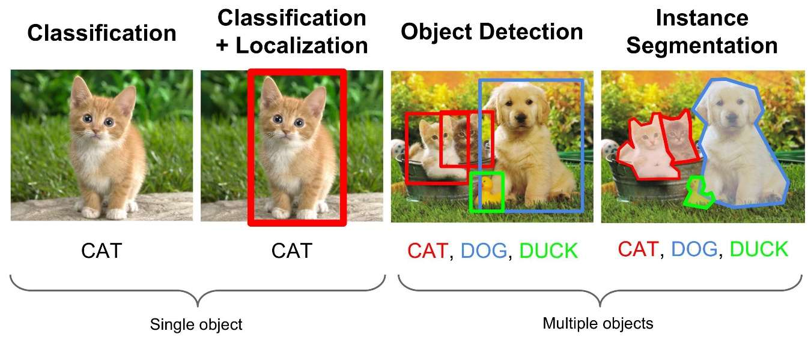

### Page 13

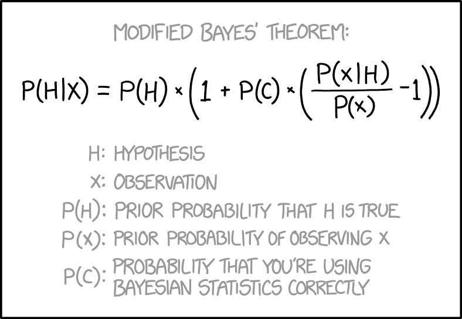

### Page 16

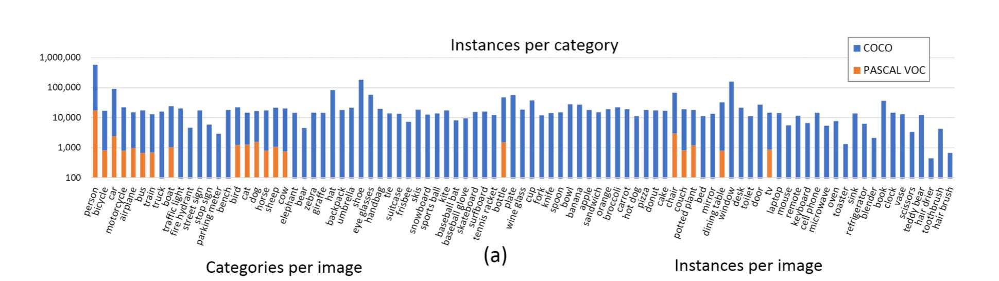

### Page 17

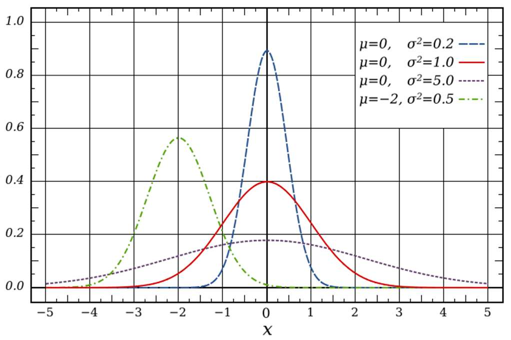

### Page 21

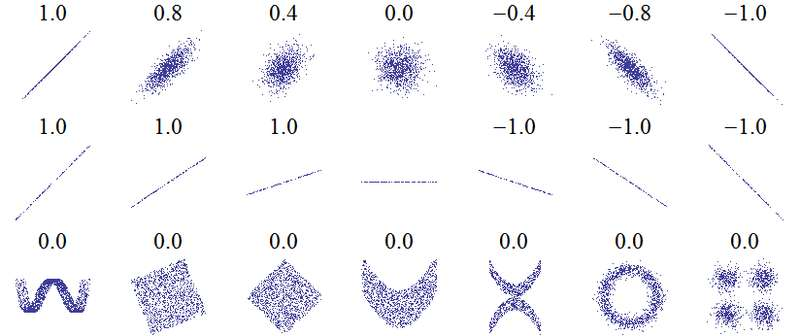

### Page 23

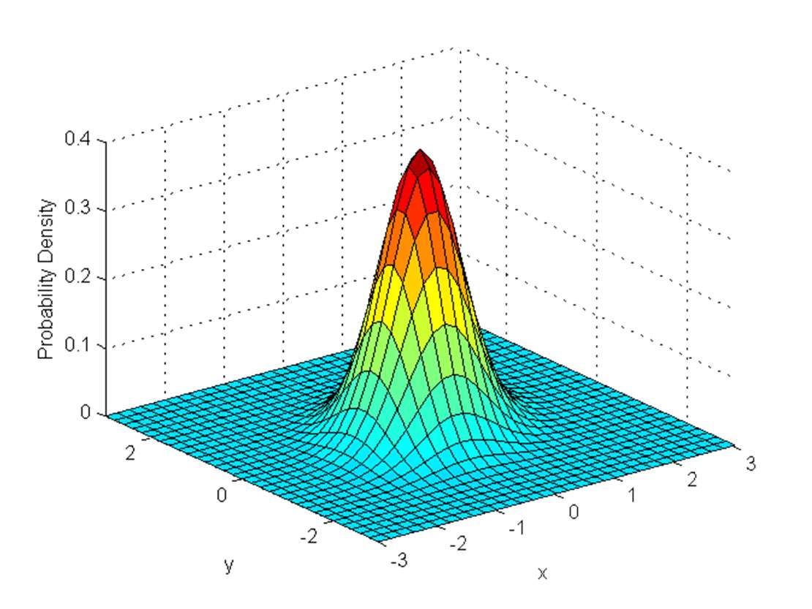

### Page 27

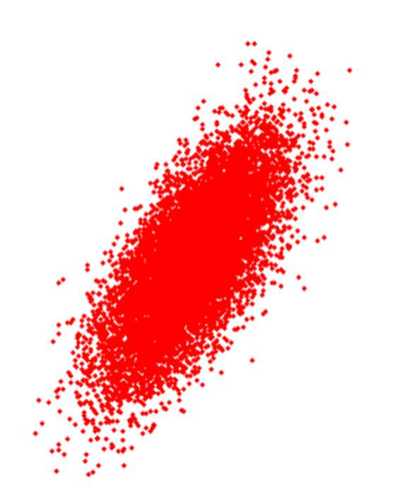

### Page 28

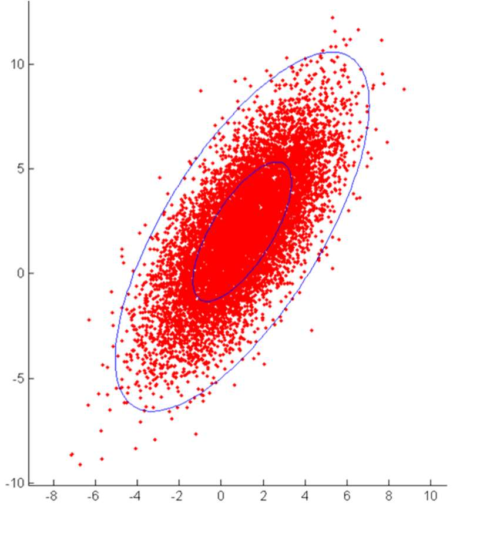

### Page 29

### Page 31

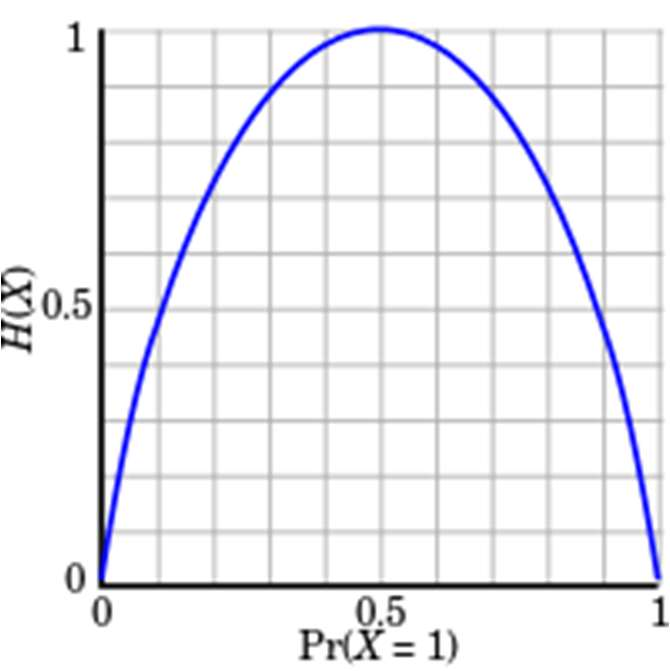

### Page 32

### Page 36

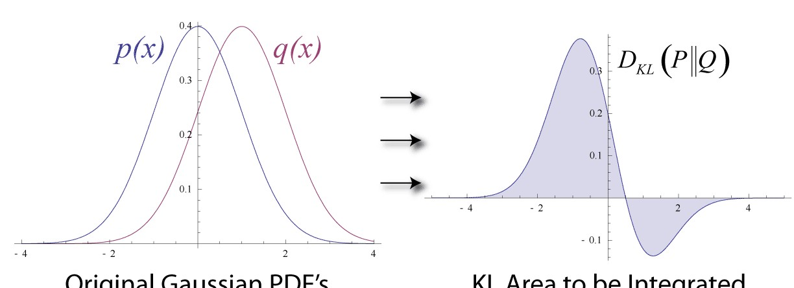
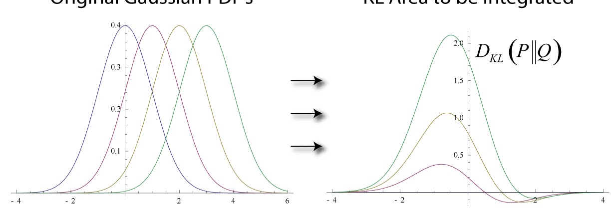

### Page 42

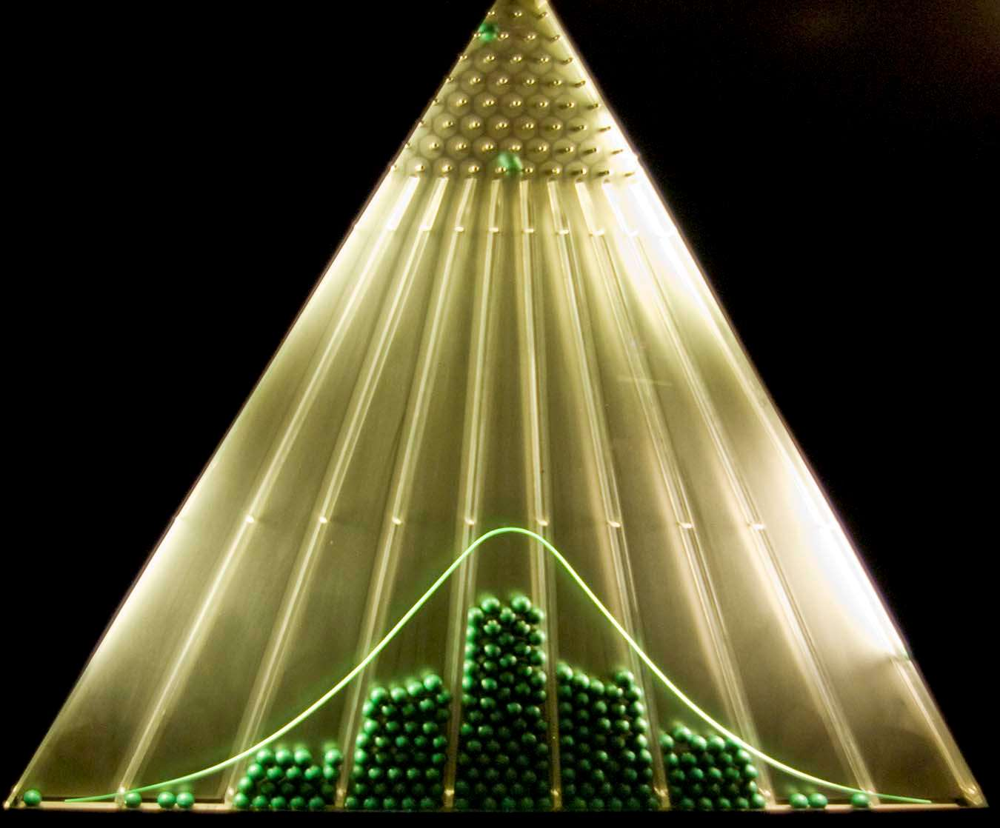
