AER 1515 – Perception for Robotics
Lecture 3 – Optimization
Prof. Steven Waslander

Optimization Improvements
• Jacobian and multi-dimensional problems
• Multi-objective optimization
• A couple of related examples for quadratic and NLP optimizations
• A conversion of a nonconvex problem to a convex problem for robotics
• Some example with Gaussians being optimized (MAP, ML)
• More detail on Lagrange multipliers and constrained solutions
• Connect to machine learning lecture
2

Outline
• Optimality and Unconstrained Optimization
• Conditions for optimality
• Optimization problem types
• Some solution methods
3

Unconstrained Optimization
• Given a function that maps a vector of variables to the reals
𝑓(𝑥)
𝑓:ℝ(cid:3041) → ℝ
• Find the minimum (or maximum) values of f (x)
min 𝑓(𝑥)
(cid:3051)∈ℝ(cid:3289)
𝑥
• Must map to a single value that ranks solutions and defines optimality (cid:2870)
𝑥
(cid:2869)
• The gradient and Hessian of the function f (x) are usually assumed to exist,
requires some smoothness
• Gradient:
• Hessian
4

Unconstrained Optimization
• Minima:
• Local minimum,    𝑥 ∗:
|                   | 0 such that 𝑓(𝑥∗) | −𝑥∗||                      |     |
| ----------------- | ----------------- | -------------------------- | --- |
| There exists an 𝜀 | >                 | ≤ 𝑓(𝑥), for all 𝑥 with ||𝑥 | < 𝜀 |
5

Unconstrained Optimization
• Minima:
• Global minimum, 𝑥: ∗
6

Conditions For Optimality
• For differentiable cost functions, can perform Taylor series expansion to find
optimality conditions
• Taylor series of f(x) about x
1
𝑓(𝑥+Δ𝑥)=𝑓(𝑥)+∇𝑓(𝑥)(cid:3021)Δ𝑥+ Δ𝑥(cid:3021)∇(cid:2870)𝑓(𝑥)Δ𝑥+𝐻.𝑂.𝑇.
2
7

Conditions For Optimality
• Necessary conditions (NC)
• If  x* is a local minimum, difference between minimum and
nearby point  should be non-negative by definition
𝑓(𝑥)
| 𝑓(𝑥∗  | 𝑓(𝑥∗) |     |
| ----- | ----- | --- |
| + Δ𝑥) | −     | ≥ 0 |
• Similarly, for a negative step in x, the difference should be non-
negative
−Δ𝑥 Δ𝑥
| 𝑓(𝑥∗ − Δ𝑥) | − 𝑓(𝑥∗) | ≥ 0 |
| ---------- | ------- | --- |
8

Conditions For Optimality
• Necessary conditions (NC)
• As Δx->0, higher order terms in Taylor series disappear
| 𝑓(𝑥 + Δ𝑥) | − 𝑓(𝑥) | ≈ ∇𝑓(𝑥)(cid:3021)Δ𝑥 |     |
| --------- | ------ | ------------------- | --- |
−Δ𝑥 Δ𝑥
• First order term must  satisfy above for Δx AND –Δx in each
element of x
| ∇𝑓(𝑥∗)(cid:3021)Δ𝑥 | ≥ 0 and ∇𝑓(𝑥∗)(cid:3021)(−Δ𝑥) |     | ≥ 0 |
| ------------------ | ----------------------------- | --- | --- |
• Necessary condition for optimality
Δ𝑥
−Δ𝑥
|     | ∇𝑓(𝑥∗)(cid:3021) = | 0   |     |
| --- | ------------------ | --- | --- |
9

Conditions for Optimality
• Sufficient conditions
• Of all points that satisfy necessary conditions for optimality, which ones are truly local
minima?
• For all small excursions from optimal solution, cost increases
| • Since  | ∇𝑓(𝑥∗)(cid:3021) |     |     |
| -------- | ---------------- | --- | --- |
= 0
• This means
1
Δ𝑥(cid:3021)∇(cid:2870)𝑓(𝑥)Δ𝑥
|     | 𝑓(𝑥 + Δ𝑥) | − 𝑓(𝑥) ≈ | > 0 |
| --- | --------- | -------- | --- |
2
| • And so | the sufficient condition for x* |     | to be a local minimum is  |
| -------- | ------------------------------- | --- | ------------------------- |
∇(cid:2870)𝑓(𝑥∗) is positive definite
10

Optimality Conditions
• Note that these conditions are only useful if the gradient and Hessian
exist
• Otherwise, resort to initial definition of optimality and demonstrate
directly
• Integer optimization
𝑓(𝑥)
𝑥∈𝑁
11

Constrained Optimization
• Standard form:
|     | min | 𝑓(𝑥) |     |
| --- | --- | ---- | --- |
(cid:3051)∈(cid:3025)
|  subject to |     |  𝑔(𝑥) ≤ 0 |     |
| ----------- | --- | --------- | --- |
 ℎ(𝑥) = 0

• where
|                               |         | ℝ(cid:3043),ℎ:𝑋 | ℝ(cid:3044)  |
| ----------------------------- | ------- | --------------- | ------------ |
| 𝑋 can be any type of set, 𝑓:𝑋 | → ℝ,𝑔:𝑋 | →               | →            |
• Specific classes of problems, depending on definitions of X, f, g, h.
• Very specific optimization engines, for every shade of problem
12

Lagrangian and Lagrange Multipliers
• By introducing Lagrange multipliers, can convert constrained problem to
an unconstrained problem
• Can directly apply unconstrained optimization technique to Lagrangian
• Results in expanded necessary and sufficient conditions for optimality
• In practice, best optimization algorithms treat constraints in a few
different ways
13

Constrained Optimization
• Equality Constraints
• Must be active, Lagrange multipliers must be non-zero
• Inequality Constraints (Karush, Kuhn, Tucker)
• If active, Lagrange multipliers are non-negative
• If inactive, Lagrange multipliers are zero
∇ 𝐿(𝑥∗,𝜆∗,𝜇∗) = 0
(cid:3051)
𝜆∗ ≥ 0,𝑖 = 1,…,𝑚
(cid:3036)
𝜆∗ = 0,𝑖 ∉ 𝐴(𝑥∗)
(cid:3036)
• A(x*) is the set of active constraints
14

Constrained Minima
• If no active constraints, reverts to
unconstrained problem
ℎ(𝑥,𝑦) = 0
• For active constraints
• Gradient of cost must be perpendicular to active
constraint at minimum
• Otherwise moving along constraint would reduce cost
and remain feasible
• Can be expressed as
∇𝑓(𝑥∗,𝑦∗) + 𝜈(cid:3021)∇ℎ(𝑥∗,𝑦∗) = 0
• with Lagrange multiplier ≠ 0
15

Lagrangian Duality
• We define the Lagrangian dual function as the infimum of the Lagrangian
over x
|        |                       |                       | 𝜆(cid:3021)𝑔(𝑥) | 𝜈(cid:3021)ℎ(𝑥) |
| ------ | --------------------- | --------------------- | --------------- | --------------- |
| 𝑑(𝜆,𝜈) | = inf𝐿(𝑥,𝜆,𝜈)         | = inf 𝑓(𝑥)            | +               | +               |
|        | (cid:3051)∈(cid:3025) | (cid:3051)∈(cid:3025) |                 |                 |
The Lagrange variables are now called dual variables and d(λ,υ) is concave in λ,υ
•
• This dual function yields lower bounds on the optimal f(x)
|     |     | 𝑑(𝜆,𝜈) ≤ | 𝑝∗  |     |
| --- | --- | -------- | --- | --- |
• We can now form the Lagrange dual problem
• What is the maximum lower bound that can be obtained from the dual function?
Leads to certificate of optimality
|     |     | max  | 𝑑(𝜆,𝜈) |     |
| --- | --- | ---- | ------ | --- |
|     |     | 𝑠.𝑡. | 𝜆 ≥ 0  |     |
16

Optimization Problem Taxonomy
17

Optimization Problem Types
• Linear Program (LP)
• (P) Easy, fast to solve, convex
𝑓(cid:3021)𝑥
min
(cid:3051)∈(cid:3025)⊆ℜ(cid:3289)
|     |  𝐴𝑥 ≤ | 𝑏   |     |
| --- | ----- | --- | --- |
s.t.
|     |  𝐴 𝑥                 | = 𝑏                  |     |
| --- | -------------------- | -------------------- | --- |
|     | (cid:3032)(cid:3044) | (cid:3032)(cid:3044) |     |
• Matlab command:
• x = linprog(f, A, b, Aeq, beq, LB, UB, x0)
• Python command:
| • scipy.optimize.linprog(f, | A, b, Aeq, | beq, bounds, | x0) |
| --------------------------- | ---------- | ------------ | --- |
18

Optimization Problem Types
• Quadratic Program (QP)
• (P) Quadratic cost with linear constraints O(n3)
• Still fairly easy, fast to solve and convex
min 𝑥(cid:3021)𝑄𝑥 + 𝑐(cid:3021)𝑥
(cid:3051)∈(cid:3025)⊆ℜ(cid:3289)
𝐴𝑥 ≤ 𝑏
s.t.
𝐴 𝑥 = 𝑏
(cid:3032)(cid:3044) (cid:3032)(cid:3044)
• Matlab command:
• x = quadprog(Q, A, b, c, Aeq, beq, LB, UB, x0)
• Python command:
• Go straight to scipy.optimize.minimize()
• Examples with closed form solutions: Kalman filter, LQR
19

Convexity
• Definition: A set, C, is convex if any two points, x , x , in C can be
1 2
connected by a line entirely in C.
• That is, for all Ɵ in [0,1], we have
| 𝜃𝑥 +       | (1 − 𝜃)𝑥   | ∈ 𝐶 |
| ---------- | ---------- | --- |
| (cid:2869) | (cid:2870) |     |
Convex Nonconvex
20

Convexity
• Definition: A function, f(x), is convex if for any two points, x , x , and for
1 2
all Ɵ in [0,1], we have
| 𝑓(𝜃𝑥       | + (1 − 𝜃)𝑥 | ) ≤ 𝜃𝑓(𝑥   | ) + (1     | − 𝜃)𝑓(𝑥 )  |
| ---------- | ---------- | ---------- | ---------- | ---------- |
| (cid:2869) |            | (cid:2870) | (cid:2869) | (cid:2870) |
|            | 0.5𝑓(𝑥     | ) + 0.5𝑓(𝑥 | )          |            |
|            |            | (cid:2869) | (cid:2870) |            |
𝑓(𝑥 )
(cid:2869)
𝑓(𝑥 )
(cid:2870)
|     | 𝑓(0.5𝑥 | + 0.5𝑥 | )   |     |
| --- | ------ | ------ | --- | --- |
(cid:2869) (cid:2870)
Convex Nonconvex
21

Convexity
• A convex function has an epigraph that is a convex set
Epigraph
of
• Definition: A Convex Optimization problem is one where f(x)
• f(x) is a convex function
• g(x) is a convex function
• h(x) is an affine function
• This definition ensures the feasible region is a convex set
• Convex optimization problems have a unique global
minimum!
• Common examples: linear programs, quadratic programs,
geometric programs, second order cones and more
22

Optimization Problem Types
• Convex Program
• (P) Convex problems are easy to solve, come with a certificate of optimality
• f(x) and g(x) are convex functions, h(x) is affine
• Good python solver: cvxopt, cvxpy, many others
23
Robotics
ME
780:
Autonomous
Mobile

Optimization Problem Types
• Non-Linear Program (NLP)
• Non-convex problems are harder to solve, not guaranteed to find global optimum (local
minima can occur)
• Matlab:
• fmincon
• Python
• scipy.optimize.minimize, ipopt
24
Robotics
ME
780:
Autonomous
Mobile

Optimization Problem Types
• (Non-linear) Least Squares
• Extremely common problem formulation with customized solution methods
ME 780: Autonomous Mobile
Robotics
| • Linear least squares:  f(x) = Ax |             | – b |
| ---------------------------------- | ----------- | --- |
| • State estimation:  f(x           | ) = y – h(x | )   |
|                                    | t t         | t   |
• Gauss-Newton and Levenberg-Marquardt solvers
• Leaving for AER 1513
25

Optimization Problem Types
• Mixed Integer Linear Program (MILP)
• (NP-hard)  computational complexity
𝑓(cid:3021)𝑥
min
(cid:3051)∈(cid:3025)
|     |  𝐴𝑥 ≤ | 𝑏   |
| --- | ----- | --- |
s.t.
|         |  𝐴                   | = 𝑏                  |
| ------- | -------------------- | -------------------- |
|         | (cid:3032)(cid:3044) | (cid:3032)(cid:3044) |
| where 𝑋 | ⊆ 𝑍(cid:3041)        | × ℜ(cid:3041)        |
|         | (cid:3284)           | (cid:3293)           |
• Exponential growth in complexity
• However, many problems can be solved surprisingly quickly
• CPLEX, Gurobi
• MINLP, MILQP etc.
26

Solution Methods for Linear Programs
• Simplex Method
• For a linear program, optimum must be at the intersection of constraints
• Intersections are easy to find, change inequalities to equalities, add slack variables
• Jump from one vertex to the next (in a smart way), until no more improvement is
possible
x
2
f T
x
1
27

Generic Solvers - Gradient Descent
• At any point, the negative gradient vector
defines a direction of steepest descent locally
• Given a feasible solution x , there exists α > 0 such that
k
for
• The step size or learning rate ( α ) can be defined in
advance, or found via line search
• Constant step size
• Diminishing step size
• Exact and inexact line search
• Termination based on gradient magnitude (NC check)
28

Newton-Raphson Method
• Based on the second order Taylor series approximation instead of the
first for gradient
• Jumps to the solution of the quadratic approximation to f for α = 1
• Many extensions, and customizations
29

Solution Method for Nonlinear Programs
• Interior Point Methods
• Apply Barrier Function to each constraint and sum
• Primal-Dual Formulation
• Newton Step
• At each iteration,
• increase slope of barriers
x
• Benefits
2
• Applicable to all convex problems
• Scales better than Simplex for LP
-fT
• Certificate of Optimality
• Stop whenever
• Know how close to optimal
x
1
the current solution is
• Relies on duality
30

Solution Methods For Nonlinear Programs
• Sequential Quadratic Programming
• Also an interior point method
• At each iteration, calculate gradient and Hessian of Lagrangian
• Use Newton step direction as a descent direction and apply a line search
• Finding Newton step involves inverse of Hessian
• Can be approximated through diagonal, BFGS, delayed updates
31

Solution Methods for Integer Programs
| • Enumeration – |     | Tree Search, Dynamic Programming etc. |     |      |     |      |     |     |
| --------------- | --- | ------------------------------------- | --- | ---- | --- | ---- | --- | --- |
|                 |     | x =0                                  |     | x =1 |     | x =2 |     |     |
|                 |     | 1                                     |     |      |     | 1    |     |     |
1
| X =0 | X =1 | X =2 | X =0 | X =1 | X =2 | X =0 | X =1 | X =2 |
| ---- | ---- | ---- | ---- | ---- | ---- | ---- | ---- | ---- |
| 2    | 2    | 2    | 2    | 2    | 2    | 2    | 2    | 2    |
• Guaranteed to find a feasible solution (only consider integers, can check feasibility
(P) )
• But, guaranteed exponential growth in computation time
32

Solution Methods for Integer Programs
• How about solving LP Relaxation followed by rounding?
Integer Solution
-f T
x
2
LP Solution
x
1
33

Integer Programs
x
2
-f T
x
1
• LP solution provides lower bound on IP
• But, rounding can be arbitrarily far away from integer solution
34

Combined approach to Integer Programming
• Why not combine both approaches!
• Solve LP Relaxation to get fractional solutions
• Create two sub-branches by adding constraints
x x
2 2 x ≥2
2
-f T -f T
x ≤1
x 2 x
1 1
35

Branch and Bound Method
• Solve LP relaxation for lower bound on cost for current branch
• If solution exceeds upper bound, branch is terminated
• If solution is integer, replace upper bound on cost if lower
• Create two branched problems by adding constraints to original problem
• Select integer variable with fractional LP solution
• Add integer constraints to the original LP
• Repeat until no branches remain, return optimal solution.
36

Solution Methods for Integer Programs
• Branch and Bound
• Branch as above
• LP give lower bound, feasible solutions give upper bound
LP
J* = J
0
|     |     |            |      |     | x =4.3, x | = 1.9  |     |            |      |     |     |
| --- | --- | ---------- | ---- | --- | --------- | ------ | --- | ---------- | ---- | --- | --- |
|     |     | LP + x     | ≤1   |     | 1         | 2      |     | LP + x     | ≥2   |     |     |
|     |     |            | 2    |     |           |        |     |            | 2    |     |     |
|     |     | J* = J     |      |     |           |        |     | J* = J     |      |     |     |
|     |     |            | 1    |     |           |        |     |            | 2    |     |     |
|     |     | x = 3.6, x | = 1  |     |           |        |     |            |      |     |     |
|     |     |            |      |     |           |        |     | x = 4.2, x | = 2  |     |     |
|     |     | 1          | 2    |     |           |        |     | 1          | 2    |     |     |
LP + x ≤3 + x ≤1 LP + x ≥4 + x ≤1 LP + x ≤4 + x ≥2 LP + x ≥5 + x ≥2
|              | 1      | 2   |     | 1          | 2   |              | 1      | 2   |     | 1          | 2   |
| ------------ | ------ | --- | --- | ---------- | --- | ------------ | ------ | --- | --- | ---------- | --- |
|              | J* = J |     |     | J* = J     |     |              | J* = J |     |     | J* = J     |     |
|              |        | 3   |     |            | 4   |              |        | 5   |     |            | 6   |
| Worse than J |        |     |     | Infeasible |     | True optimum |        |     |     | Infeasible |     |
5

Integer Programs
• Order matters
• All solutions cause branching to stop
• Each feasible solution is an upper bound on optimal cost, allowing elimination of
nodes
x
2
Branch x
1
-cT
x
1
Branch x Branch x
1 2
then x
2 38

Additional Refinements –Cutting Planes
• Idea stems from adding additional constraints to LP to improve tightness
of relaxation
• Combine constraints to eliminate non-integer solutions
All feasible

integer
x
2
solutions
remain feasible
Current LP

solution is not
feasible
x
1
Added Cut
39

Summary
• Optimization involves identifying solutions that meet necessary and sufficient
conditions for optimality
• Often only possible to identify locally optimal solution
• Problem complexity depends on characteristics of cost, constraints, domain
• Huge taxonomy of different problems, each with their own solution methods
• Convex/non-convex the main threshold between easy and hard, then
differentiable/non-differentiable
• A wide array of solution methods exist, easily employed through standard
software packages
• As problem size increases as in deep learning, reversion to gradient methods
necessary
• Memory limitation becomes primary factor in selection of search method
40

## Extracted Images

### Page 1

### Page 4

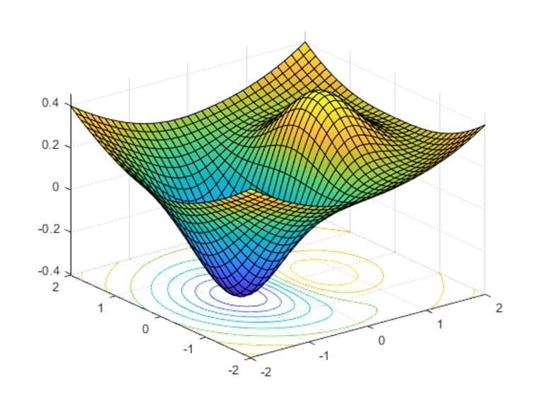

### Page 5

### Page 6

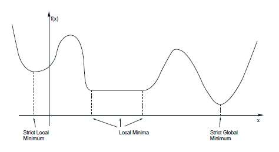

### Page 7

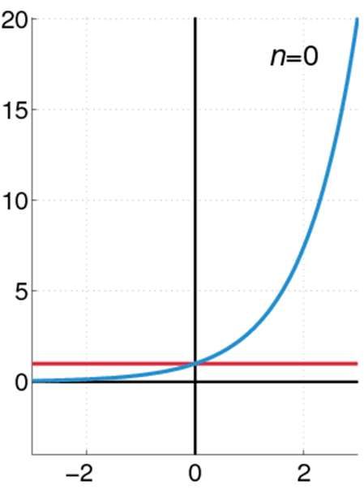

### Page 15

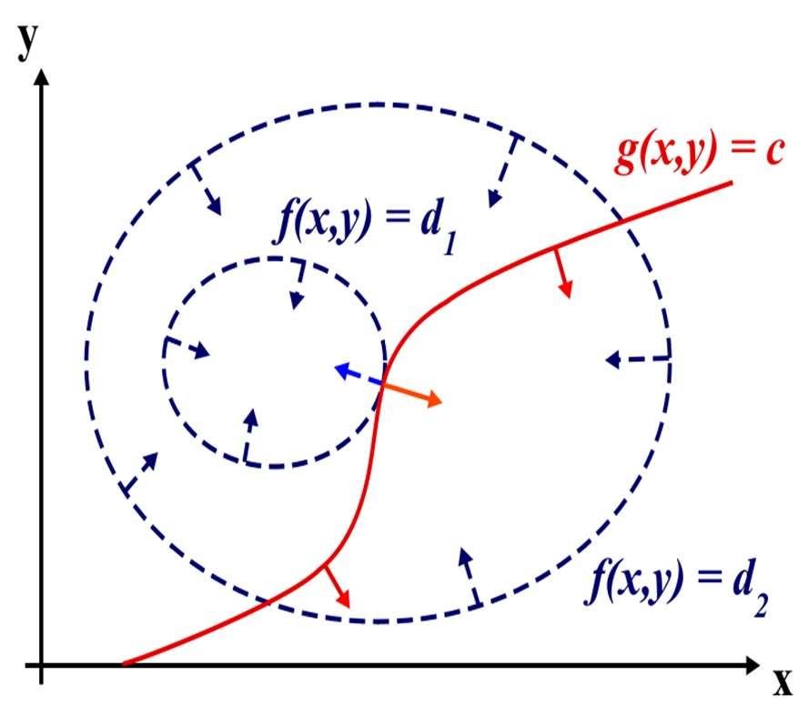

### Page 17

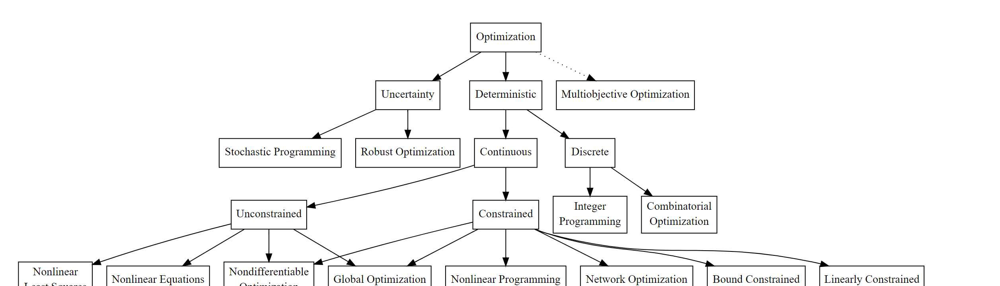
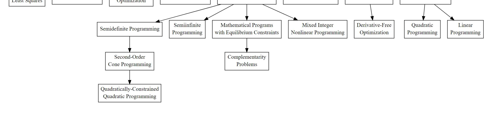

### Page 22

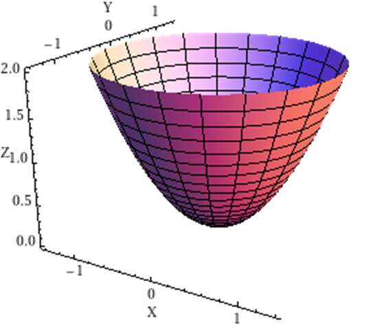

### Page 27

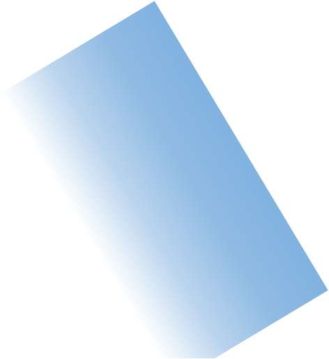
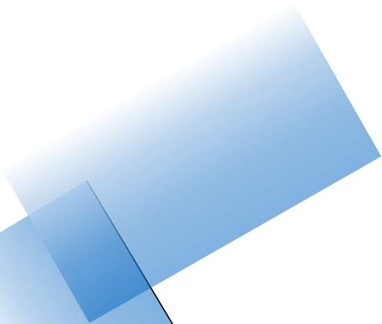
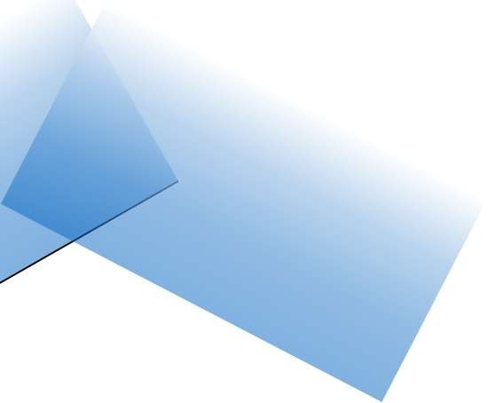

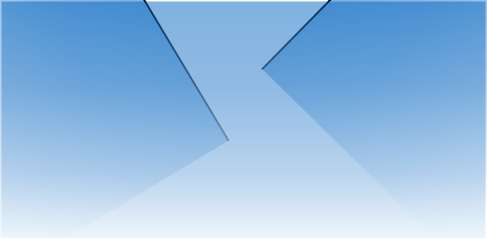

### Page 28

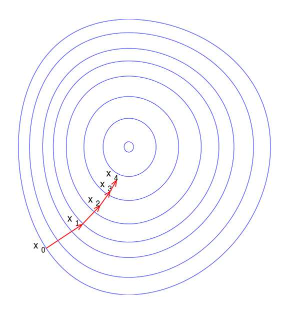
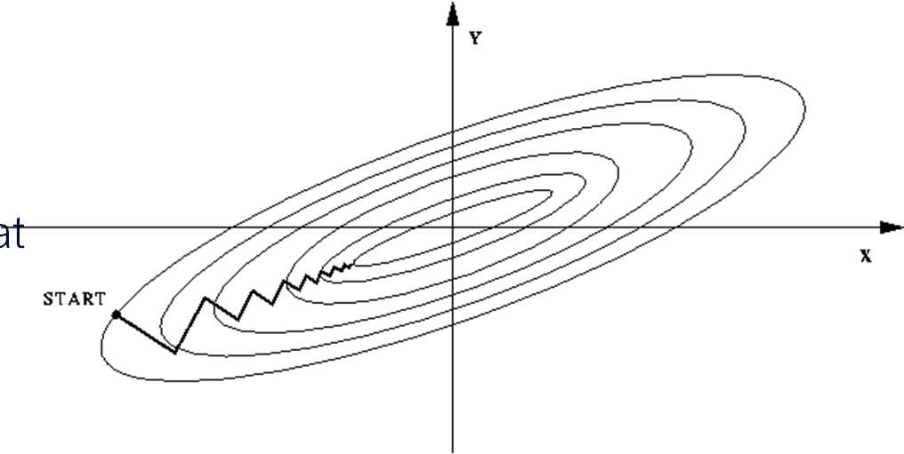

### Page 29

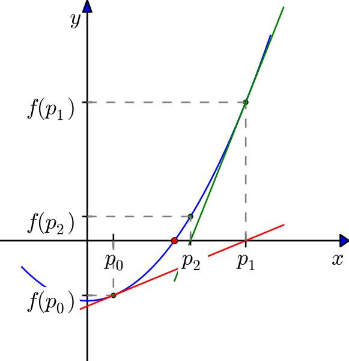

### Page 30

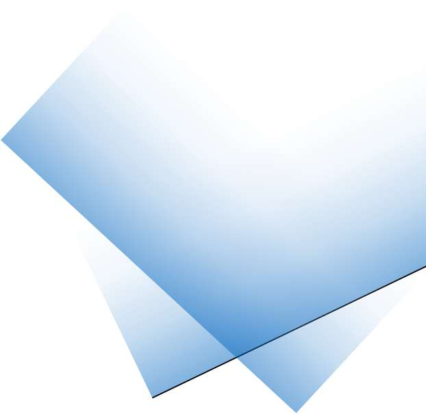
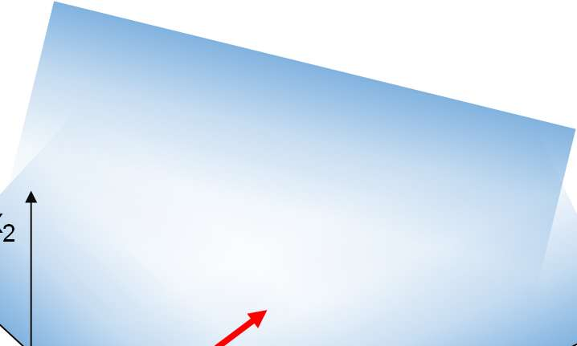
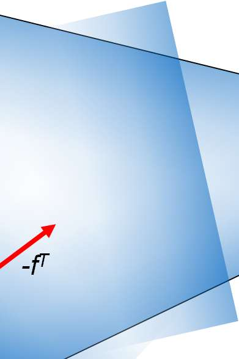
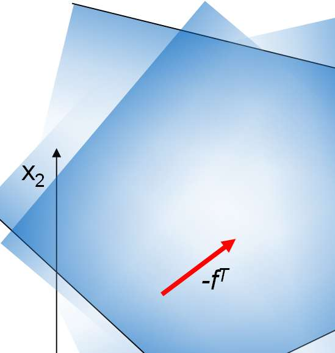

### Page 31

### Page 33

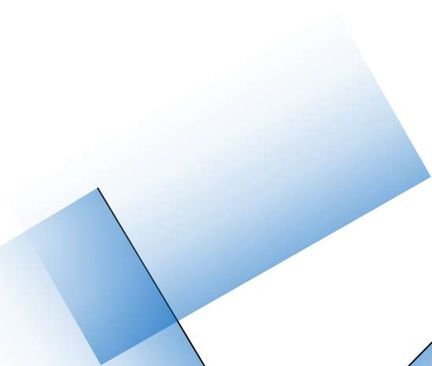

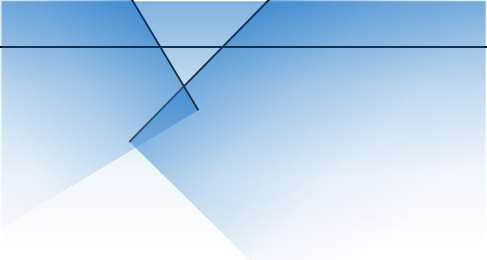

### Page 34

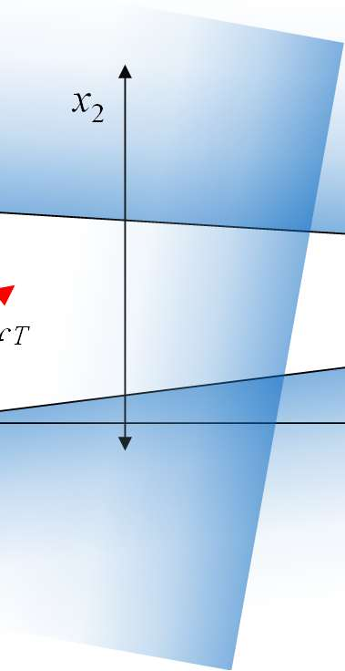

### Page 35

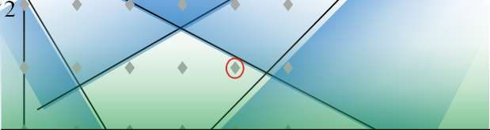
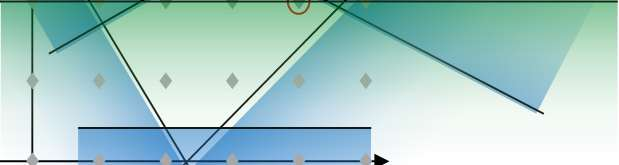

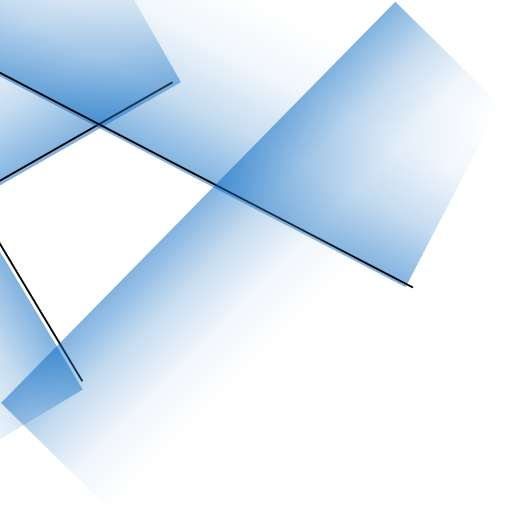
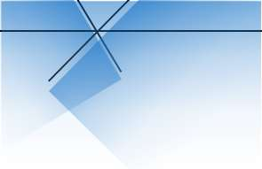

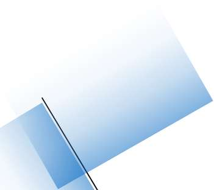
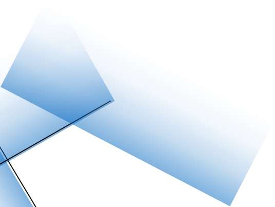

### Page 38

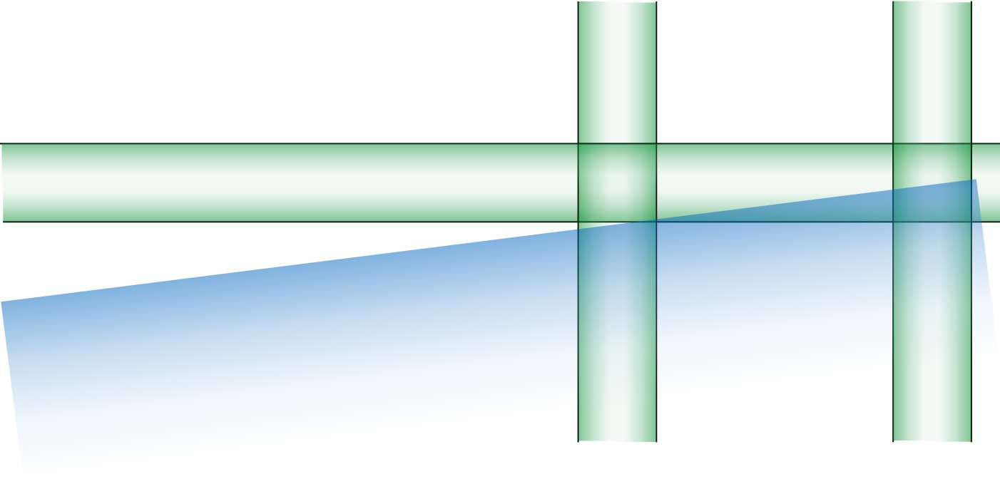
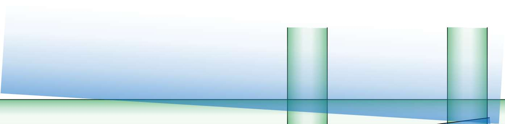
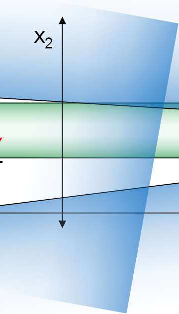

### Page 39

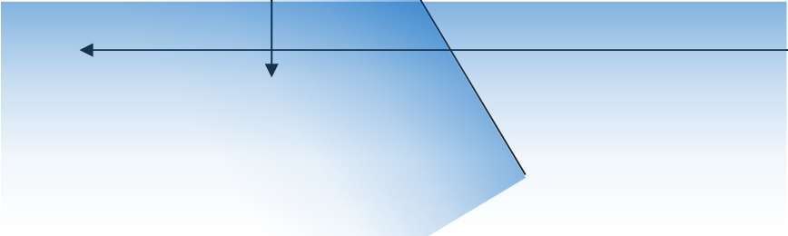
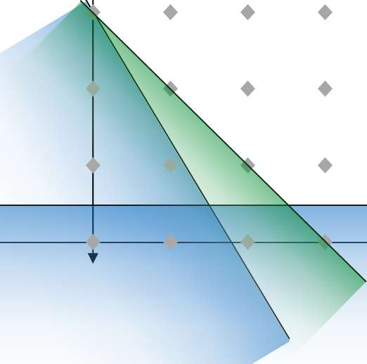
